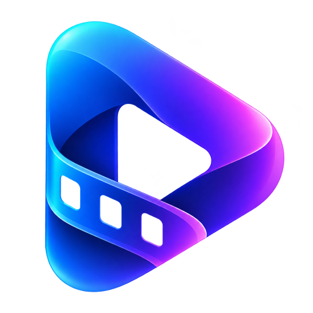

<div align="center">



# Nahhasio

**An Arabic-first media library for Linux, built for my family.**

Catalog Arabic dubs, keep a watch history for each account, and play videos from your own collection.

[](#installation)

[](LICENSE)

[](#built-with)
[](#built-with)
[](#built-with)
[](#built-with)

[About](#about-the-project) · [Screenshots](#screenshots) · [Highlights](#highlights) · [Installation](#installation) · [Development](#build-from-source) · [Docs](docs/README.md)

</div>

---

## About the project

I started Nahhasio to organize the films and series my family watches and to keep track of the
Arabic dubs we grew up with. It’s a personal project shaped by how we use it at home. I relied
heavily on LLMs while building it, including **Claude Opus 5** and **GPT 6 Sol**, to write and revise code.

> [!IMPORTANT]
> **The Nahhasio project hosts no films, series, or streams.**
> The project shares the software. Each household supplies its own catalog and videos. A
> self-hosted Nahhasio server can serve video files from that household’s collection.

## Built with

| Part               | Stack                                                              |
| ------------------ | ------------------------------------------------------------------ |
| Linux app          | Rust, GTK4, libadwaita, WebKitGTK                                  |
| Interface          | React, TypeScript, Vite                                            |
| Player             | libmpv                                                             |
| Server and catalog | Rust, Axum, SQLx, PostgreSQL                                       |
| Deployment         | Flatpak for the client, rootless Podman and Quadlet for the server |

---

## Screenshots

Save your captures under `assets/readme/` using the filenames below. From the repository root,
run `pnpm --filter @nahhasio/website sync:screenshots` to refresh this gallery and rebuild the site.

<!-- screenshot-gallery:start -->

### Desktop

<div align="center">
  <table>
    <tr>
      <td align="center"><b>Home</b><br /><em>Screenshot pending</em><br /><code>desktop-home.webp</code></td>
      <td align="center"><b>Browse</b><br /><em>Screenshot pending</em><br /><code>desktop-browse.webp</code></td>
    </tr>
    <tr>
      <td align="center"><b>Work details</b><br /><em>Screenshot pending</em><br /><code>desktop-work.webp</code></td>
      <td align="center"><b>Watch</b><br /><em>Screenshot pending</em><br /><code>desktop-watch.webp</code></td>
    </tr>
    <tr>
      <td align="center"><b>People</b><br /><em>Screenshot pending</em><br /><code>desktop-people.webp</code></td>
      <td align="center"><b>Studios</b><br /><em>Screenshot pending</em><br /><code>desktop-studios.webp</code></td>
    </tr>
    <tr>
      <td align="center"><b>Settings</b><br /><em>Screenshot pending</em><br /><code>desktop-settings.webp</code></td>
      <td align="center"><b>Library administration</b><br /><em>Screenshot pending</em><br /><code>desktop-admin.webp</code></td>
    </tr>
  </table>
</div>

### Mobile layout

These phone-width views show the responsive layout. The packaged client is for Linux.

<div align="center">
  <table>
    <tr>
      <td align="center"><b>Home</b><br /><em>Screenshot pending</em><br /><code>mobile-home.webp</code></td>
      <td align="center"><b>Browse</b><br /><em>Screenshot pending</em><br /><code>mobile-browse.webp</code></td>
      <td align="center"><b>Browse filters</b><br /><em>Screenshot pending</em><br /><code>mobile-filters.webp</code></td>
      <td align="center"><b>Work details</b><br /><em>Screenshot pending</em><br /><code>mobile-work.webp</code></td>
    </tr>
    <tr>
      <td align="center"><b>Episodes</b><br /><em>Screenshot pending</em><br /><code>mobile-episodes.webp</code></td>
      <td align="center"><b>Watch</b><br /><em>Screenshot pending</em><br /><code>mobile-watch.webp</code></td>
      <td align="center"><b>Profile</b><br /><em>Screenshot pending</em><br /><code>mobile-profile.webp</code></td>
      <td align="center"><b>Settings</b><br /><em>Screenshot pending</em><br /><code>mobile-settings.webp</code></td>
    </tr>
  </table>
</div>

<!-- screenshot-gallery:end -->

---

## Highlights

- **Arabic-first catalog.** Search Arabic and English titles and aliases in a right-to-left interface. Keep dubbing credits, seasons, episode details, artwork, and editorial notes together.
- **Four ways to browse.** Switch between posters, banners, logos, and a table. Each view remembers its own display settings.
- **Watch tracking for each account.** Resume where you left off, mark episodes or whole works as watched, and discuss titles with spoiler tags.
- **Native playback.** Play server or device files in mpv and switch between available audio and subtitle tracks.
- **Offline access.** Save catalog entries and artwork to browse offline, or download the actual video files for offline playback.
- **Desktop administration.** Edit the catalog, manage artwork and credits, and review how video files match titles and episodes before importing them.

---

## Installation

Nahhasio runs as a **home server** plus a **Linux Flatpak client**. You can install both on the same
machine or connect the client to a server elsewhere on your home network.

1. **Set up the server.** Follow the packaging guide to configure rootless Podman, PostgreSQL, and
   HTTPS on a Fedora Atomic host such as Silverblue. [Server installation](packaging/server/README.md#prepare-an-installation)
2. **Install the desktop app.** Follow the Flatpak guide to install the signed client as your
   desktop user. [Flatpak installation](packaging/flatpak/README.md#install-and-update)
3. **Connect and sign in.** Open Nahhasio, enter your server’s HTTPS address, and sign in with an
   account on that server. [Server TLS and activation](packaging/server/README.md#tls-enrollment-activation-and-maintenance)

## Build from source

### Try the local demo

With Nix and devenv installed, run the following on your Linux machine.

```sh
git clone https://github.com/AbdulrahmanNahhas/nahhasio.git
cd nahhasio
devenv up
```

This starts a local server and opens the GTK app with fictional shows. Use `admin@demo.local` to
try catalog editing or `friend@demo.local` to try the viewing experience. Both accounts initially
use the password `demo12345`.

### Develop the UI or build a Flatpak

- **Live UI development.** Run `devenv --profile dev up` for the same demo with Vite hot reload.
  [Development guide](docs/development/getting-started.md#runbuild)
- **Local Flatpak build.** Follow the packaging guide to produce an unsigned test bundle in
  `dist/`. [Flatpak build guide](packaging/flatpak/README.md#build-and-runtime)

---

## Feedback

If you try Nahhasio and hit a bug, share the version, your Linux distribution, and the steps to reproduce it. Arabic wording and right-to-left layout feedback are especially welcome. [Open an issue](https://github.com/AbdulrahmanNahhas/nahhasio/issues)

## License

The source code is released under the MIT License. Each installation supplies its own catalog and videos. [Read the license](LICENSE)
