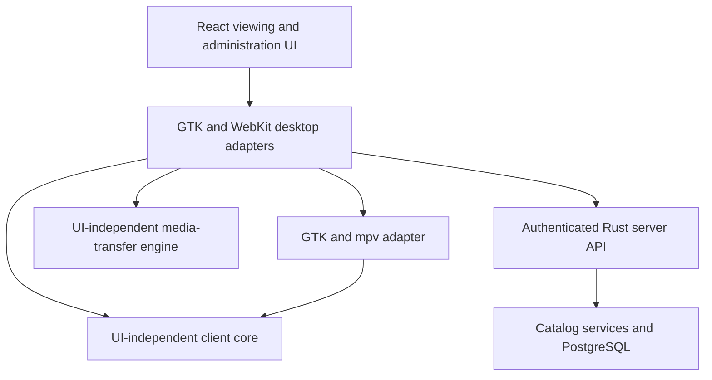

# Client architecture and migration boundaries

Updated 2026-11-15. This guide records the behavior-preserving client refactor, not approval to
replace the UI, split repositories, publish packages or add another platform. Product scope stays
in [PROJECT](../project/overview.md); checks and acceptance stay in [TESTING](../development/testing.md).

## Current boundaries

`crates/client-core` is the `nahhasio-client-core` Rust library. It currently owns:

- Frontend-safe error values and canonical resource-ID validation.
- Server-origin parsing and server-picker normalization, without creating HTTP clients.
- Browse preference documents, allowlists and validation.
- Playback preference documents, language ordering, player defaults and subtitle-style bounds.
- Single HTTP byte-range parsing, including empty files, suffixes and overflow boundaries.
- The existing Linux storage-layout policy with explicit directory inputs.

The GTK shell and mpv adapter consume these definitions; they do not retain copies of the moved
policy. The bridge re-exports the shared error and identifier validator to preserve existing call
sites and response shapes. Private preference reads/writes remain in the Linux adapter.

This is the first extraction, **not a complete portable client runtime**. Sessions, trust, HTTP,
offline packs, jobs and source coordination still largely live in `apps/linux/src`. The storage
policy retains Linux directory conventions; other OS layouts need explicit adapters/policies,
not an assumption that Linux paths become correct everywhere.

### Dependency direction

The client core must not depend on GTK, WebKit, a replacement UI toolkit, the native player, the
server, the direct-database CLI or canonical database drivers. The server and `catalog-core`
remain separate: a future desktop must continue using authenticated HTTPS, not PostgreSQL.

`pnpm check:architecture` checks the core's transitive Cargo graph, including build/dev dependencies,
all features and all targets. A dedicated CI job builds, lints and tests the core without installing
GTK, mpv or PostgreSQL. The guard itself has fixture tests. New dependencies must preserve this
boundary; a clean dependency graph does not replace behavior or security review.

Do not create a generic service locator or large trait hierarchy merely to make code appear
portable. Extract a concrete responsibility and its tests first. Introduce interfaces where a real
platform/transport capability needs substitution.

## Preservation rules

This extraction does not change the native bridge commands, OpenAPI ownership, API authorization,
Arabic messages, preference versions/filenames, catalog IDs, account/server ownership or retained
storage layout. Startup still does not migrate or seed. No existing device files are moved/reset.

- OS directory discovery remains in `apps/linux/src/media_storage.rs`; the core receives paths.
- Unix private-file permissions, atomic writes and secure credential storage remain adapters.
- TLS clients, credential renewal and authorization handling remain native-owned.
- GTK event loops, WebKit origins/CSP, dialogs and player render-context lifetime remain shell work.
- Native player defaults are shared data; mpv rendering and handles remain isolated.
- Torrent/device downloads, saved metadata and server media remain distinct workflows.
- `packages/api-contract/openapi.json` remains the single network definition. Moving types must not
  create a separately maintained Rust/TypeScript schema or hand-edit generated files.

Error envelopes, preference round-trips, player language mappings, finite numeric limits, origin
restrictions and route identifiers have core regression tests. Account-scoped persistence and
native protocol tests remain in the desktop. Browser fixtures are not native playback acceptance.

## Independent builds, repositories and updates

Separate repositories are feasible later, but repository separation and runtime update independence
are different things.

| Component                                       | Build/release boundary                                                         | Updating it                                                                      |
| ----------------------------------------------- | ------------------------------------------------------------------------------ | -------------------------------------------------------------------------------- |
| Client core library                             | Can compile/test without the desktop UI or native SDKs                         | A linked desktop must rebuild/release to incorporate a new library version       |
| Desktop application                             | Builds UI assets and its native executable with selected core/adapter versions | Flatpak/Software owns installed client updates                                   |
| Server and worker                               | Separate Rust/OCI artifacts, schema and maintenance compatibility gates        | Can update separately when the client/API and schema compatibility checks permit |
| [Planned Android client](../project/android.md) | Shares the viewing UI and versioned API contracts through a platform adapter   | Signed APK through GitHub Releases                                               |

A Rust `rlib` is not a stable plugin ABI or an independently hot-updatable installed service. Do not
add dynamic libraries, a local daemon or an executable downloader solely to avoid rebuilding a
consumer. Those are separate architectural/security decisions, not necessary consequences of
splitting Git repositories.

The desktop and player use the workspace-local `client-core` path. The core inherits the Cargo
workspace release version and registry publication is disabled. This does not establish an
independent core release pipeline or a stable public API promise.

Before an actual repository split:

1. Finish moving concrete client responsibilities behind toolkit-independent interfaces. Keep
   platform adapters outside the reusable package; account/session ownership must remain explicit.
2. Give each extracted package explicit metadata, supported toolchain/platforms, tests, license and
   a reviewed public API. Replace workspace-inherited metadata with a standalone workspace as needed.
3. Choose versioned distribution: a registry/private registry, or an exact Git revision initially.
   Avoid floating branch dependencies and cross-repository relative source paths.
4. Assign one owner to the OpenAPI definition/generator. Consumers use a pinned generated artifact
   or versioned contract package; do not fork the canonical schema or migration history.
5. Verify `cargo package`/a clean external-consumer build with only declared sources. Give the core
   and desktop separate CI/release policies and record their supported compatibility combinations.
6. Verify desktop source export, offline vendoring, Flatpak and signed release preparation from the
   resulting clean checkouts. The current Flatpak exporter uses tracked source files; uncommitted
   new crate files are not included by its `git ls-files` export.

Do not create an empty mobile package/repository now. Existing application IDs, installed paths and
server deployment policy are not renamed by this preparatory work.

## Service-layer checkpoint

The Linux service facade in `apps/linux/src/services.rs` routes native bridge calls into
feature modules for catalog, tracking, profiles, administration and media. `services/session.rs`
owns credential renewal and remembered-account behavior; `services/transport.rs` owns trusted
HTTP client setup and bounded decoding. Both still operate on the same native `ServerSession`,
so splitting the files does not introduce new session state or change account ownership.
Artwork and media have their own modules. Regular API responses still use a total deadline;
long media streams still use a read-idle deadline.

## Next architectural slices

These are identified follow-ups, not claims that the whole client has been extracted:

1. **Typed client operations:** The Linux session, transport and feature code are now organized by
   responsibility, but feature operations still receive JSON bridge commands. Expose a narrow typed
   workflow (for example, browse → work details → playback) independently of the WebKit envelope.
   Keep route allowlists, response limits and authorization with their current owners.
2. **Connection/account ownership:** `connections.rs` combines server settings, active sessions,
   revision/cancellation coordination and offline orchestration. Preserve those transitions as one
   explicit owner rather than letting each frontend implement its own account-switch behavior.
3. **Media coordination:** `media.rs` mixes source resolution, transfer orchestration and inventory
   projections. Keep `media-transfer` as the engine; extract only coordination that another frontend
   will actually reuse. Keep native dialogs and playback surfaces in adapters.
4. **Platform storage/security:** provide adapters for secure credentials, application directories,
   durable private files and selected-file access. Do not replace the existing Unix safeguards with
   a nominally cross-platform but weaker implementation.
5. **DTO generation and duplicate validation:** consolidate equivalent rules with their owning
   contract/policy. Similar HTTP/body helpers are not automatically interchangeable: session expiry,
   provider secrets and long media responses intentionally have different handling.

Use focused fixtures and package checks for each slice, then consolidated desktop acceptance. Do
not combine this work with broad dependency upgrades or visual redesigns. No performance gain is
claimed from extracting modules; address normalization avoids unnecessary transport construction,
and one media coordinator now resolves its storage roots once rather than three times.

## Routing and query ownership

- The [router](../../apps/linux/ui/src/app/router.tsx) uses hash history and intent preloading.
  Keep route modules small. Validate URL search parameters at the route and use them for
  shareable filtering, sorting and pagination. Vite already enables automatic code splitting.
- Use feature-local typed query options and pass the query's abort signal to the gateway where
  supported. Keep server and account ownership consistent when changing keys, caches or
  invalidation. Share query options between preloaders and components where both need the same
  resource. Invalidate the affected keys after a successful mutation.
- Use bounded server reads. Derive view state from query results and URL state. Keep editable
  drafts and device preferences separate from the remote cache.
- Use the official [Router data-loading guide](https://tanstack.com/router/latest/docs/guide/external-data-loading),
  [Query keys](https://tanstack.com/query/latest/docs/framework/react/guides/query-keys),
  [query cancellation](https://tanstack.com/query/latest/docs/framework/react/guides/query-cancellation),
  and [invalidation](https://tanstack.com/query/latest/docs/framework/react/guides/query-invalidation)
  for the installed versions. The desktop uses Vite and a typed bridge.
